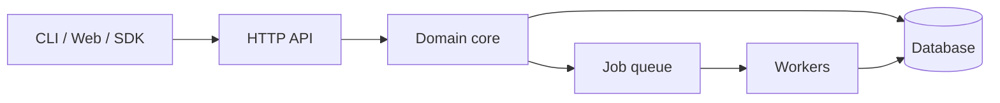
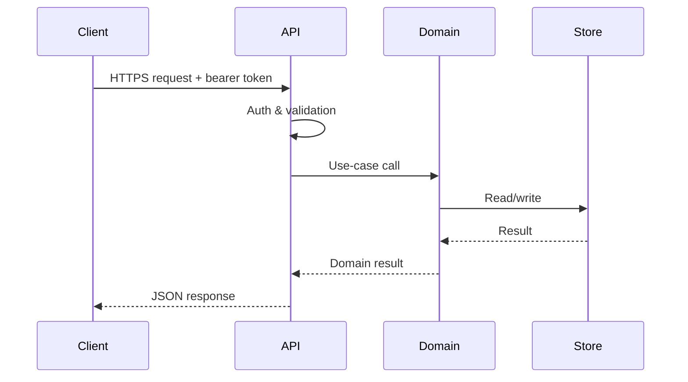

# Architecture

**Acme App** is a small control-plane style service: a CLI and HTTP API in front of a core domain layer, with optional workers for background jobs.

## High-level view

## Components

| Component | Responsibility |
| --- | --- |
| **CLI (`acme`)** | Local init, config validation, admin commands |
| **HTTP API** | REST surface for users, projects, and health |
| **Domain core** | Business rules, authorization checks, transactions |
| **Store** | Persistent state (projects, users, settings) |
| **Workers** | Async jobs such as exports and notifications |

## Request path

## Environments

| Environment | Typical use |
| --- | --- |
| `development` | Local laptop; verbose logs; hot reload optional |
| `staging` | Pre-prod verification; production-like secrets |
| `production` | Customer traffic; strict auth and monitoring |

!!! info "Placeholder boundaries"
    Treat package names (`acme-app`, `acme/app`) as rename targets when you adopt this template for a real product.
