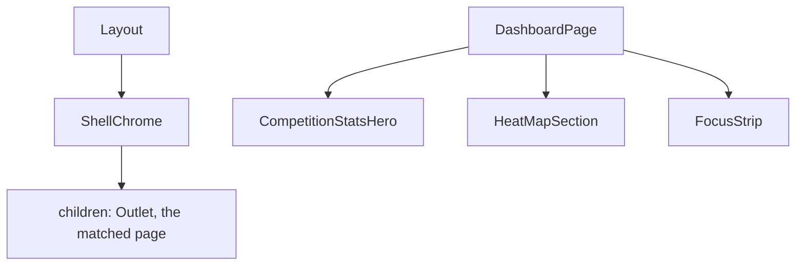

# Composition

Screens in this app are not one giant function. A parent renders child components and passes each child only what that child needs. The parent does not reach into the child to change its variables. It passes new props, and React renders the child again.

!!! tip "If you know C#"
    `Layout` plus `<Outlet />` is a Razor `_Layout.cshtml` and `@RenderBody()`. The layout here is a component, and the client route table chooses which body appears. `DashboardPage` passing `statistics={data.statistics}` is a controller handing a small view model to a partial. Those partials are functions in their own files.

## Chrome around every page

`SDSD/6.Frontend/src/components/Layout.tsx` waits for auth, then renders `ShellChrome`. The page itself is `children`. React Router fills that slot with `<Outlet />`, the matched child route.

```tsx
import { Outlet } from 'react-router'
import { useAuth } from '../auth/AuthContext'
import NotificationMenu from '../features/notifications/NotificationMenu'
import FlashAlerts from './FlashAlerts'
import ShellChrome from './ShellChrome'

export default function Layout() {
  const { state } = useAuth()

  if (state.status === 'loading') {
    return (
      <div
        className="d-flex justify-content-center align-items-center vh-100"
        data-testid="app-loading"
      >
        <div className="spinner-border text-primary" role="status">
          <span className="visually-hidden">Loading…</span>
        </div>
      </div>
    )
  }

  const identity = state.status === 'authenticated' ? state.identity : null

  return (
    <ShellChrome identity={identity} notifications={identity ? <NotificationMenu /> : null}>
      <FlashAlerts error={identity?.errorMessage} success={identity?.successMessage} />
      <Outlet />
    </ShellChrome>
  )
}
```

While `state.status === 'loading'`, the screen is a spinner and nothing else. After that, `identity` is the signed-in object or `null`. `notifications` is a component only when someone is signed in: `<NotificationMenu />` is passed as a prop, and that prop is still a `ReactNode`. Where the session value comes from is the context lesson.

`ShellChrome` (`SDSD/6.Frontend/src/components/ShellChrome.tsx`) paints the navbar and drops the two slots into place. `{notifications}` sits in the bar. `{children}` sits in the main column:

```tsx
<main className="container py-4">{children}</main>
```

One navbar entry is a client link, which the routing lesson explains. The weigh-in icon goes to `/WeighIn/Add`:

```tsx
<Link className="nav-link px-2 text-dark" to="/WeighIn/Add" title="Weigh-In">
```

The rest of the navbar is the same idea repeated. This lesson does not walk every link.



## A page that owns the data

`DashboardPage` loads one response, then renders many section components. Each section gets a field or two, not the whole response. The fetch itself is the effects lesson. The return, starting at the welcome heading, is the assembler.

The children appear in this order:

1. `PersonalGoalTimerCluster`
2. `CompetitionStatsHero`
3. `SeasonFinaleCard`, or `WeeklyResultCard` plus `TeamHonors`
4. `ProgressStatisticsCard`
5. `WeightHistoryCard`
6. `HeatMapSection`
7. `DailyChallengeSection`
8. `SeasonLeaderboard`
9. `ActionPlanCheckOffModal`
10. `FocusStrip`
11. `PersonalInsightSection`
12. `AccountabilitySection`

Two of those props show the pattern. The hero gets the statistics slice. The timer cluster gets the timers and a callback:

```tsx
<PersonalGoalTimerCluster timers={data.personalGoalTimers} onTimersChange={patchTimers} />

<CompetitionStatsHero statistics={data.statistics} hasGoalWeight={data.hasGoalWeight} />
```

`patchTimers` is how the child reports a change. The dashboard keeps the response and replaces one field:

```tsx
const patchTimers = (timers: PersonalGoalTimerDto[]) => {
  setData((prev) => (prev ? { ...prev, personalGoalTimers: timers } : prev))
}
```

`...prev` copies the previous response. `personalGoalTimers: timers` overwrites that one field. `setData` is the setter the state lesson explains on a simpler form. If `prev` is still null, the function returns `prev` unchanged. The parent never assigns into a variable inside `PersonalGoalTimerCluster`.

The same shape updates the action plan: `patchActionPlan` spreads `prev` and replaces `actionPlan`.

## A section chosen with a condition

Some children are not always there. At the end of a competition the finale replaces the weekly card. Honors render only when the response includes them:

```tsx
{data.seasonFinale ? (
  <SeasonFinaleCard seasonFinale={data.seasonFinale} />
) : (
  <>
    <WeeklyResultCard weeklyResult={data.weeklyResult} />
    {data.teamHonors ? <TeamHonors teamHonors={data.teamHonors} /> : null}
  </>
)}
```

The lists lesson goes further on `&&`, ternaries, and `map`.

## Where the files live

Shared chrome lives in `src/components/` (`Layout`, `ShellChrome`, `Alerts`). A product area lives in `src/features/<area>/` (`features/dashboard/DashboardPage.tsx` and the section components it imports). A page file owns the fetch. A section file owns one block of the screen.

## Continue

Previous: [Props](props.md).

Next: State and events.
