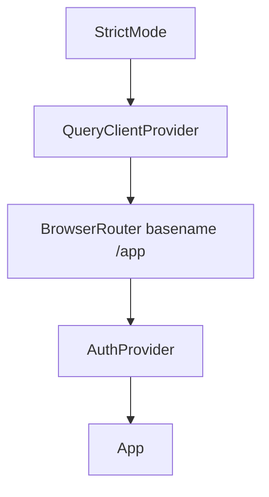

# Start here

This path is for someone who can read JavaScript (including `async`/`await`, array methods, and modules), writes backend C#, and has used TypeScript, and is new to React. The examples come from the SlimDownShowDown frontend in `SDSD/6.Frontend/`.

React is a library that runs in the browser. You write functions that describe the screen. When data changes, React calls those functions again and updates the DOM.

In SDSD the ASP.NET Core host still owns sign-in cookies, `/api`, and the HTML shell. React owns the screens under `/app/`.

!!! tip "If you know C#"
    A Razor partial is included while the server builds one response. A React component is a function the browser keeps and calls again when state changes. `createRoot(...).render(...)` mounts that tree once. It is not a request pipeline.

=== "Razor"

    The server builds HTML for one request, then the response is done. A partial is pulled in while that HTML is being built. The next click is a new request.

=== "React"

    The server sends the shell once. The browser keeps a tree of functions and calls them again when state changes. A component plays the role a partial played: a named piece of UI. The difference is that the function is still there after the first response, ready to run again.

## Where the code lives

The React source is `SDSD/6.Frontend/src/`. The host page is `SDSD/6.Frontend/index.html`. It is almost empty: styles, a mount point, and the script that starts React.

```html
<link rel="stylesheet" href="/lib/bootstrap/dist/css/bootstrap.min.css" />
<link rel="stylesheet" href="/lib/bootstrap-icons/font/bootstrap-icons-subset.css" />
<link rel="stylesheet" href="/css/site.css" />
```

```html
<div id="root"></div>
<script type="module" src="/src/main.tsx"></script>
```

Styling is still Bootstrap classes on the elements (`className` in the components), plus the host stylesheet. There is no separate design system and there are no CSS modules.

`src/main.tsx` finds `#root` and renders `<App />` inside a few wrappers. `SPA_BASENAME` is `'/app'`, the same prefix the host uses. If `devServerLandingUrl` returns a URL, the page redirects to the host and never mounts — that is what happens when you open the Vite port directly. How to start the host and Vite is in [Run the React frontend](run-the-react-frontend.md).

```tsx
const landing = devServerLandingUrl(window.location, webAppOrigin())
if (landing) {
  window.location.replace(landing)
} else {
  const SPA_BASENAME = '/app'

  createRoot(document.getElementById('root')!).render(
    <StrictMode>
      <QueryClientProvider client={queryClient}>
        <BrowserRouter basename={SPA_BASENAME}>
          <AuthProvider>
            <App />
          </AuthProvider>
        </BrowserRouter>
      </QueryClientProvider>
    </StrictMode>
  )
}
```

The `!` after `getElementById('root')` tells TypeScript the node exists. `index.html` is what puts it there.



| Wrapper | What it is for |
| --- | --- |
| `StrictMode` | Extra checks in development. It does not change the production screen. |
| `QueryClientProvider` | Holds a cache for TanStack Query. One screen uses it. The server-state lesson covers that. |
| `BrowserRouter` | Picks a page from the URL. The basename means route paths do not repeat `/app`. The routing lesson covers that. |
| `AuthProvider` | Holds who is signed in, so screens can read it without passing it through every parent. The context lesson covers that. |
| `App` | The route table. It decides which page component the URL shows. |

Open `SDSD/6.Frontend/src/main.tsx` next to this page. The `QueryClient` just above the render turns retries and refetch-on-focus off. That detail belongs with the notification bell, not here.

## What this path will not teach

How the host proxies `/app/` to Vite, how a refresh falls back to `index.html`, and the list of `/api` prefixes are already written:

- [Run the React frontend](run-the-react-frontend.md) — start the AppHost or Vite, npm scripts, ports.
- [React frontend](../reference/react-frontend.md) — how the SPA is hosted, the route areas, session, and API prefixes.

A lesson may show a few lines from those files, then send you there for the operational detail.

## What you can take to another job

Function components, JSX, props, state, effects, lists, and context are the transferable core. This path teaches those in that order, using this app's files.

Three habits here differ from many React jobs. This app keeps server data in component state and refetches by calling a load function again. Many jobs use TanStack Query (or a similar cache) for almost every request. One screen here uses that cache; that lesson is the bridge. This app uses controlled `useState` fields for forms. Many jobs add a form library on top of the same idea. Routes here copy old MVC paths, and some actions call `window.location.assign` for a full page load. The router ideas still transfer. The path strings are local.

## Reading order

Each lesson assumes the one before it.

| Lesson | Idea | Open in `SDSD/6.Frontend/` |
| --- | --- | --- |
| Start here | What React is in this app, and this path | `index.html`, `src/main.tsx` |
| [Components and JSX](components-and-jsx.md) | A component is a function that returns UI | `src/features/shared/ChallengeStatusBadge.tsx` |
| [Props](props.md) | Arguments in, including callbacks | `src/components/Alerts.tsx`, `src/components/ConfirmModal.tsx` |
| [Composition](composition.md) | Parents render children | `src/components/Layout.tsx`, `src/components/ShellChrome.tsx`, `src/features/dashboard/DashboardPage.tsx` |
| [State and events](state-and-events.md) | `useState` and controlled inputs | `src/features/weighin/SetGoalWeightPage.tsx` |
| [Lists and conditions](lists-and-conditions.md) | `&&`, ternary, `map`, `key`, early return | `src/components/Alerts.tsx`, `src/pages/PinLoginPage.tsx`, `src/features/rules/RulesPage.tsx` |
| [Load data on mount](effects-and-loading.md) | Fetch after the first paint | `src/features/rules/RulesPage.tsx`, `src/pages/PinLoginPage.tsx` |
| [Routing](routing.md) | The URL picks the page | `src/App.tsx`, `src/features/team/TeamDetailsPage.tsx` |
| Context | One value many components can read | `src/auth/AuthContext.tsx`, `src/components/Layout.tsx` |
| Call the JSON API | `api.get` / `api.post` and `ApiError` | `src/api/client.ts`, `src/features/weighin/SetGoalWeightPage.tsx` |
| Server state with TanStack Query | The one polled query | `src/features/notifications/NotificationMenu.tsx`, `src/main.tsx` |
| TypeScript in components | Props, events, unions, `api.get<T>` | `src/auth/AuthContext.tsx`, `src/components/ConfirmModal.tsx` |
| Read a page | Walk one page from top to bottom | `src/pages/PinLoginPage.tsx`, then `src/features/dashboard/DashboardPage.tsx` |
| Test a component | Vitest and Testing Library | `src/pages/PinLoginPage.test.tsx` |

## A small first file

Before the next lesson, open `SDSD/6.Frontend/src/features/shared/ChallengeStatusBadge.tsx`. It is the smallest component in the path: one function, no state, a `<span>` with a Bootstrap badge class.

## Continue

Next: [Components and JSX](components-and-jsx.md).
