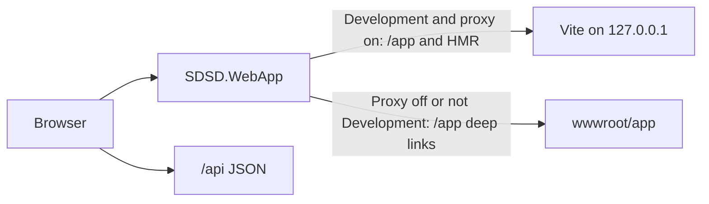

# React frontend

The React app in `SDSD/6.Frontend/` is the product UI. It is a Vite + React + TypeScript single-page app mounted at `/app/` on `SDSD.WebApp`. The browser talks to the JSON API on that same origin. There is no separate frontend host and no token exchange.

## Stack

From `SDSD/6.Frontend/package.json`:

| Package | Role |
| --- | --- |
| React 19 and `react-dom` | UI |
| React Router 7 | Client routes under the `/app` basename |
| TanStack Query 5 | Notification bell polling. Other screens call `api` directly. |
| Bootstrap 5 and Bootstrap Icons | Layout and icons |
| `@simplewebauthn/browser` | Passkey registration and sign-in from the browser |
| Vite 8 | Dev server and production bundle |
| TypeScript 6 | `tsc -b` before `vite build` |
| Vitest 5 and Testing Library | Unit tests (`jsdom`, setup in `src/test/setup.ts`) |
| ESLint 10 and Prettier | Lint and formatting. Prettier is configured in `.prettierrc.json` (no semicolons, single quotes). |

## How a request is served



Two host middlewares share one path check (`SpaPathMatcher`):

- **Development, `Frontend:UseProxyToSpaDevServer` true.** `SpaDevServerProxyMiddleware` forwards `/app` HTTP requests and the Vite HMR websocket to `Frontend:SpaDevServerUri`. Paths outside `/app` continue to MVC and static files.
- **Everywhere else.** `SpaFallbackMiddleware` returns `wwwroot/app/index.html` for `/app` navigations so client routes work on refresh. A missing build falls through. A last path segment that contains a dot is treated as a file and is not replaced with the shell.

Vite is configured with `base: '/app/'` and writes the bundle to `SDSD/SDSD.WebApp/wwwroot/app` (`emptyOutDir: true`). React Router uses the same basename:

```tsx
<BrowserRouter basename="/app">
```

`index.html` loads the host's site stylesheet and Bootstrap from `/css/site.css` and `/lib/bootstrap/...`. `src/main.tsx` also imports the npm Bootstrap CSS and Bootstrap Icons into the module graph. Those host URLs resolve when the page is loaded from the web host.

If the document is opened on the Vite origin, `devServerLandingUrl` sends the browser to the same `/app` path on the web host (default `https://localhost:7001`). Vite itself answers `/Account` and `/Login` with a redirect to `VITE_WEBAPP_ORIGIN` so an OAuth or login URL does not stay on the dev server.

## Paths that stay on the host

`SpaPathMatcher` leaves these paths on ASP.NET Core even when the SPA prefix is the whole site:

| Path | Why it stays on the host |
| --- | --- |
| `/api` | JSON API |
| `/hangfire` | Hangfire dashboard |
| `/signin-…` | External-login callbacks |
| `/Home/Error` | Error page |
| `/Account/Login`, `/Account/ExternalLoginCallback`, Facebook login and email confirmation, Google and Facebook link confirmation, `/Account/ExternalLoginFailure`, `/Account/Logout`, `/Account/DevAutoLogin`, `/Account/E2EUserLogin` | OAuth, link confirmation, logout, and test sign-in |

PIN login, PIN change, PIN reset, access denied, and passkey management are React routes under `/app`.

After a host sign-in, `SpaRedirect` sends the browser to a local `returnUrl` when one was supplied, and otherwise to `Frontend:SpaBasePath` (`/app/`).

## Source layout

```text
SDSD/6.Frontend/src/
  main.tsx              # providers, basename, Vite-origin redirect
  App.tsx               # route table
  api/                  # fetch wrapper and XSRF cookie reader
  auth/                 # /api/auth/me session and web-app origin helpers
  components/           # shell, navbar, alerts, confirm modal
  pages/                # PIN login
  features/<area>/      # one folder per product area
  test/setup.ts
```

Feature folders: `account`, `accountability`, `actionplan`, `admin`, `dashboard`, `heatmap`, `insights`, `leaderboard`, `notifications`, `passkey`, `personal`, `rules`, `shared`, `team`, `weighin`.

Playwright tests address the UI with `data-testid`.

## Routes

Routes in `src/App.tsx` reuse the old MVC path shape under `/app`. Examples: `/app/WeighIn/Add`, `/app/LeaderBoard`, `/app/Team/Details/:id`. Many screens also register an `/Index` alias (`LeaderBoard/Index`, `Team/Index`, and so on).

`Layout` waits on the auth request, then renders `ShellChrome` and the matched page. The index route and the `*` route both render the dashboard when `/api/auth/me` reports a team, and the team-selection page otherwise.

| Area | Path under `/app` |
| --- | --- |
| Home | `/` |
| Team selection and membership | `Login/SelectTeam`, `Login/LoginPrompt`, `Team`, `Team/Create`, `Team/Details/:id`, team edit steps |
| Account | `Account/PinLogin`, `Account/ChangePin`, `Account/ResetPin`, `Account/AccessDenied`, `Passkey/Manage` |
| Weigh-in | `WeighIn/Add`, `WeighIn/SetGoalWeight`, `WeighInHistory` |
| Leaderboard | `LeaderBoard`, `LeaderBoard/Snapshot` |
| Insights and habits | `Insights`, `Insights/StartExperiment`, `Insights/Experiment/:id`, `ActionPlan`, `ActionPlan/Day`, `Accountability`, `DailyChallenge/History`, `DailyChallenge/Details/:id` |
| Sharing and notices | `HeatMapSharing`, `Notification` |
| Content | `Home/Privacy`, `Home/DataDeletion`, `Home/Rules` |
| Admin | `Admin`, `Admin/Teams`, `Admin/DeletedTeams`, `Admin/DeletedUsers`, `Admin/Logins`, `Home/MoveWeighIns` |

## Session and API calls

`AuthProvider` loads `GET /api/auth/me` once. A successful body becomes the signed-in identity (`authStatus` of `authenticated` or `inTeam`). A failed call leaves the UI anonymous. A later `401` from `apiFetch` dispatches `auth:unauthorized`, and the provider drops back to anonymous.

`src/api/client.ts` is the shared caller:

- `credentials: 'same-origin'` so the auth cookie is sent
- `Accept: application/json`
- `POST` bodies are JSON
- `204` responses resolve as `undefined`
- Problem responses use `detail` or `title` as `ApiError.message`

Unsafe methods (`POST`, `PUT`, `PATCH`, `DELETE`) copy the `XSRF-TOKEN` cookie into the `RequestVerificationToken` header. `GET /api/auth/me` (and `POST /api/auth/me`) set that cookie from the ASP.NET Core antiforgery request token. The host registers `AutoValidateAntiforgeryToken` on MVC, so those requests must echo the token. The cookie is not `HttpOnly`, is `SameSite=Lax`, and uses `Secure` on HTTPS.

TanStack Query is created in `main.tsx` with `retry: false` and `refetchOnWindowFocus: false`. The notification menu is the screen that uses it: `GET /api/notifications/recent` on a 60-second interval.

## JSON API the UI calls

Controllers live in `SDSD/SDSD.WebApp/Controllers/Api/`. They share `ApiBaseController` (current user, admin check, antiforgery cookie, MediatR). Route prefixes:

| Prefix | Controller |
| --- | --- |
| `/api/auth` | Sign-in session: `me`, PIN login, team select, join by code, switch team, logout |
| `/api/account` | PIN change and related account security |
| `/api/dashboard` | Home dashboard |
| `/api/weigh-ins` | Add a weigh-in |
| `/api/weigh-in-history` | History |
| `/api/leaderboard` | Leaderboard and snapshot |
| `/api/teams` | Team pages and the create/edit wizard |
| `/api/insights` | Personal insights and experiments |
| `/api/action-plans` | Action plans |
| `/api/accountability` | Accountability partners |
| `/api/daily-challenges` | Daily challenges |
| `/api/heat-map-sharing` | Heat-map sharing |
| `/api/notifications` | Notification list and read state |
| `/api/personal-goal-timers` | Personal goal timers |
| `/api/passkeys` | Passkey management |
| `/api/team/rules` | Rules |
| `/api/admin` | Admin users, teams, logins, deleted records |
| `/api/impersonation` | Start and stop impersonation |

Business rules stay in the MediatR handlers the host already uses. The React pages call these routes through `api.get` and `api.post`.

## Solution and build output

`SDSD/6.Frontend/SDSD.Frontend.csproj` uses the NoTargets SDK. It lists the frontend sources so they travel with the solution. The `BuildFrontend` target runs `npm ci` and `npm run build` only when `BuildReactFrontend=true`.

The dev entry point that starts Vite beside the host is `SDSD/4.Infra/SDSD.AppHost/AppHost.cs` (`AddViteApp` on `../../6.Frontend`). See [Run the React frontend](../guides/run-the-react-frontend.md) for the commands and configuration keys.
